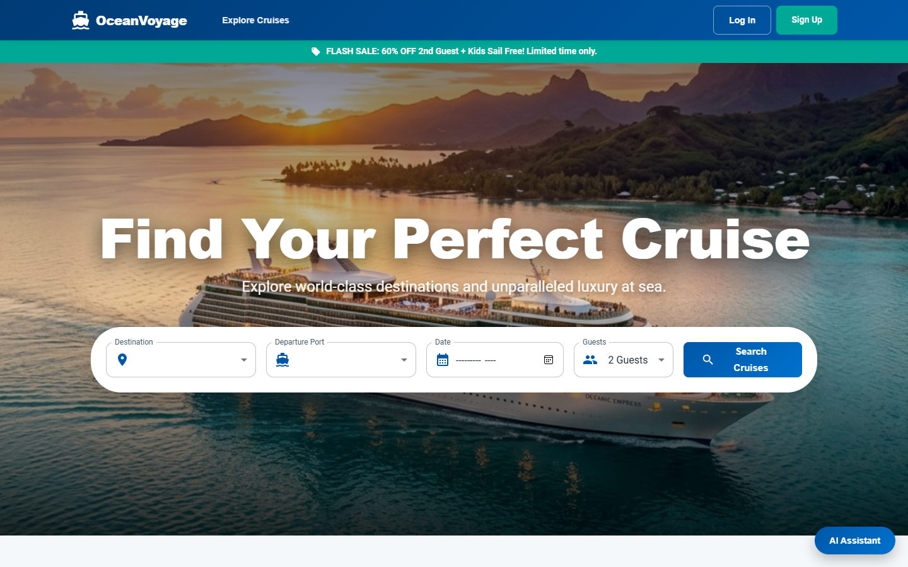
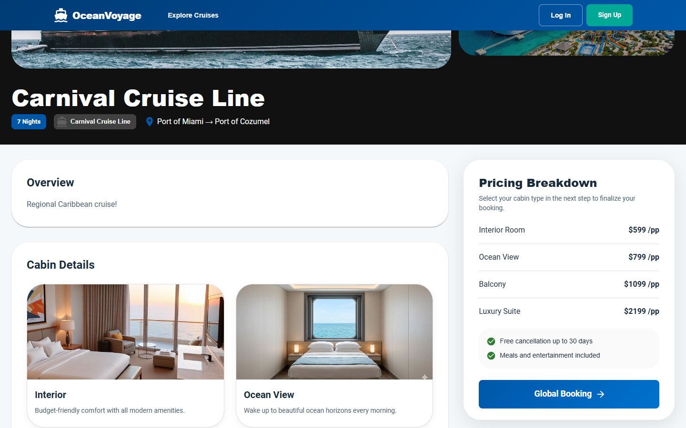
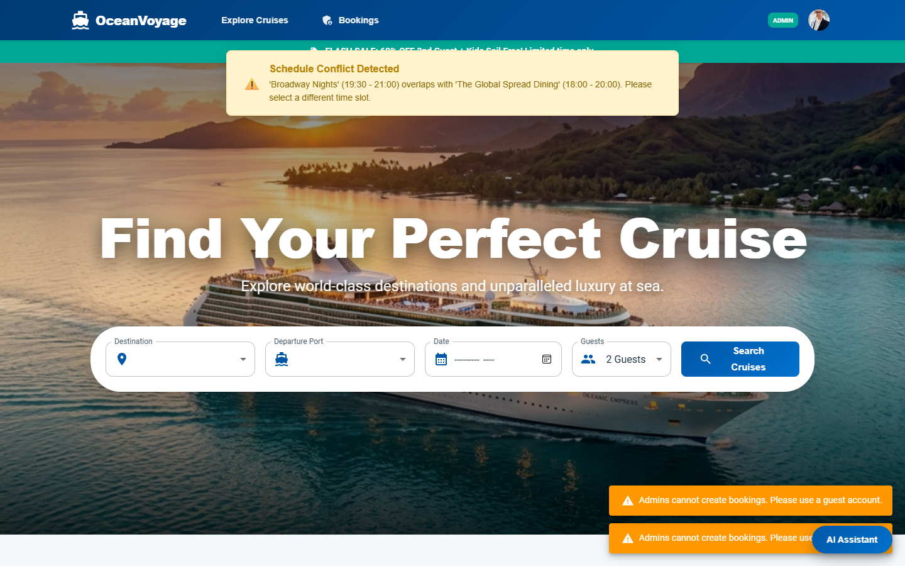
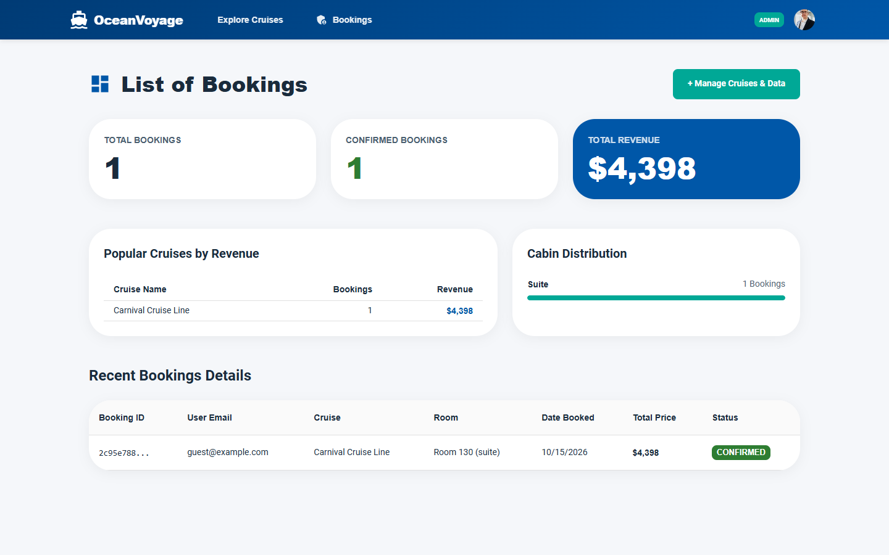

<div align="center">

# 🚢 OceanVoyage

**A full-stack cruise booking platform with real-time activity conflict detection.**

[](https://nestjs.com/)
[](https://nextjs.org/)
[](https://www.typescriptlang.org/)
[](https://www.postgresql.org/)

🏆 *Built at a hackathon at Technopark, in collaboration with ICT Academy of Kerala and Royal Caribbean Group*

</div>

---

## 📑 Table of Contents
- [Overview](#-overview)
- [Screenshots](#-screenshots)
- [Features](#-features)
- [Tech Stack](#-tech-stack)
- [Project Structure](#-project-structure)
- [Getting Started](#-getting-started)
- [Demo Credentials](#-demo-credentials)
- [Roadmap](#-roadmap)
- [Team](#-team)

---

## 📖 Overview
OceanVoyage delivers a premium cruise booking experience from search to confirmation. Guests browse voyages, preview cabins, and book onboard activities. The system warns them instantly if two activities overlap in time. Admins manage ships, cruises, and bookings from a dedicated dashboard.

*This project was built as a team during a hackathon held at Technopark, in collaboration with ICT Academy of Kerala and Royal Caribbean Group.*

---

## 📸 Screenshots

| Home / Search | Cabin Selection |
| :---: | :---: |
|  |  |

| Conflict Warning | Admin Dashboard |
| :---: | :---: |
|  |  |

---

## ✨ Features

### 🧳 For Guests
- **Dynamic itineraries:** Detailed day-by-day schedules for every voyage.
- **Visual cabin selection:** Image previews for all room types.
- **Activity packages:** Add onboard experiences to a booking.
- **Conflict detection:** Real-time warnings when selected activities overlap.

### 🛠️ For Admins
- Manage cruises and ships.
- View booking metrics and activity.

### 🎨 Experience
- Responsive, luxury-styled UI built with Next.js and Material UI.

---

## 🧱 Tech Stack

| Layer | Technology |
| :--- | :--- |
| **Frontend** | Next.js 14, React 18, TypeScript, Material UI |
| **Backend** | NestJS, TypeScript, TypeORM, Express-Session, CSURF |
| **Database** | PostgreSQL |

---

## 📂 Project Structure

```text
OceanVoyage/
├── cruise-backend/        # NestJS API server
├── cruise-frontend/       # Next.js frontend client
├── docs/                  # Documentation & screenshots
└── SETUP_WINDOWS.bat      # One-click setup helper (Windows)
```

---

## 🚀 Getting Started

### Prerequisites
- [Node.js (v20+)](https://nodejs.org/)
- [PostgreSQL (v14+)](https://www.postgresql.org/)

---

### Option A: Windows (Quick)

1. Double-click **`SETUP_WINDOWS.bat`**. It checks Node.js, creates `.env` templates, and installs dependencies.
2. Create an empty PostgreSQL database named `cruise_booking`.
3. Set your database password in `cruise-backend/.env` (see below).
4. Seed the data, then start both servers (see **Seed and Run**).

---

### Option B: Manual (Any OS)

```bash
git clone https://github.com/MEHTHAB-N-M/OceanVoyage.git
cd OceanVoyage

# Install backend dependencies
cd cruise-backend && npm install

# Install frontend dependencies
cd ../cruise-frontend && npm install
```

#### Configure the Database
Edit `cruise-backend/.env`:
```env
DB_HOST=localhost
DB_PORT=5432
DB_USERNAME=postgres
DB_PASSWORD=YOUR_POSTGRES_PASSWORD_HERE
DB_NAME=cruise_booking
```

> [!IMPORTANT]
> Create the empty `cruise_booking` database in PostgreSQL before seeding.

#### Seed and Run

**Terminal 1 (Backend):**
```bash
cd cruise-backend
npm run seed       # Seeds ships, cruises, rooms, and activity packages
npm run start:dev  # Starts API on http://localhost:3001
```

**Terminal 2 (Frontend):**
```bash
cd cruise-frontend
npm run dev        # Starts frontend on http://localhost:3000
```

Open [http://localhost:3000](http://localhost:3000) in your browser.

---

## 🔑 Demo Credentials

| Role | Email | Password |
| :--- | :--- | :--- |
| **Admin** | `admin@cruiseline.com` | `Admin1234!` |
| **Guest** | `guest@example.com` | `Guest1234!` |

> [!NOTE]
> Demo data only. Not for production use.

---

## 🗺️ Roadmap
- [ ] Online payment integration
- [ ] Email booking confirmations
- [ ] Docker Compose setup
- [ ] Reviews and ratings

---

## 👥 Team

| Member | Role |
| :--- | :--- |
| **Mehthab N M** | Database & Backend |
| **Aswin Suresh** | Security & Backend|
| **Durga Sunil** | Frontend |

**Mehthab N M:** [Portfolio](https://mehthab-n-m.github.io/My_portfolio/) · [GitHub](https://github.com/MEHTHAB-N-M) · [LinkedIn](https://www.linkedin.com/in/mehthab-n-m-637611344)

---

<div align="center">
⭐ <i>If you like this project, consider giving it a star!</i>
</div>